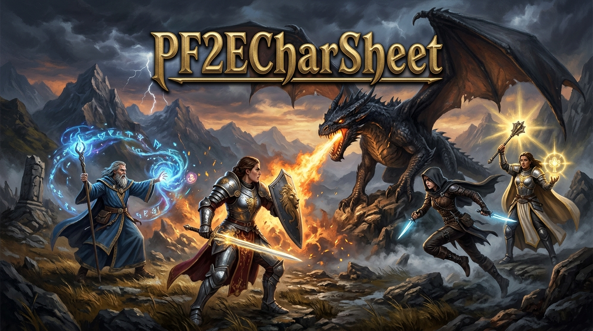

> **[Read in English](README.md)**

# Pathfinder Character Manager 2eR

Gerenciador de personagens desktop e web para **Pathfinder 2e Remaster**, desenvolvido com React, TypeScript, Electron e SQLite.

## Principais Recursos

- **Criador de Personagens (ABC)**: assistente passo a passo para Ancestralidade, Antecedente, Classe, 4 Aumentos Livres e Perícias Treinadas Iniciais (com cálculo automático de perícias fixas e compensação por sobreposição).
- **Ficha e Progressão de Nível (1–20)**:
  - **Combate**: controle de PV na sessão, condições, escudo/CA e ataques corpo a corpo e à distância (*Strikes*).
  - **Perícias**: 16 perícias padrão + perícias de **Lore (Conhecimento)** específicas com graduação T/E/M/L.
  - **Talentos**: espaços de Ancestralidade, Classe, Gerais, Perícia e Arquétipo Livre opcional, com verificação de pré-requisitos e filtros para Arquétipo/Multiclasse/Dedicação.
  - **Magias**: Ataque Mágico, CD de Magia, Espaços de Magia (1–10), vínculo com Grimório e *Signature Spells*.
  - **Inventário e Volume (Bulk)**: catálogo de equipamentos, moedas, armadura/escudo equipados e cálculo de Bulk (`5 + FOR` sobrecarregado / `10 + FOR` máximo).
  - **Companions**: companheiros animais, familiares, eidolons e construtos.
  - **Progressão de Nível**: planejador 1–20 com boosts parciais (`>= +4`), teto de proficiência por nível (`3+/7+/15+`) e modo configurável de PV (padrão PF2e, média arredondada para cima ou rolagem por nível).
- **Grimório e Compêndios**: busca em Magias, Talentos e Equipamentos, além de construtor de Grimório com impressão em cartas estilo tarô e exportação JSON.
- **Exportação e Importação**: exporte personagens para PDF preenchível de Pathfinder 2e (com portrait embutido) ou `.pf2char.json`, e importe arquivos `.json`.
- **Interface Bilíngue**: alternância entre Português (`pt-BR`) e Inglês, com temas Marinho, Claro e Escuro.

## Instalação para Desenvolvimento

É necessário **Node.js 22.13+** com `node:sqlite` disponível.

```sh
npm install
npm run dev
```

A instalação cria `pf2e.db` com o esquema necessário quando o arquivo ainda não existe. O comando é idempotente e não apaga personagens, grimórios ou compêndios existentes. Para inicializar manualmente:

```sh
npm run db:init
```

O banco é local e não é enviado ao Git. Ele contém os dados dos seus personagens e grimórios, portanto inclua-o nos seus backups pessoais.

## Dados dos Compêndios

Em um banco novo, `npm install` também tenta baixar o repositório [Foundry PF2e](https://github.com/foundryvtt/pf2e) na revisão `52dfeee703b887237f5e454747bcae45b136f9af` e importar seus arquivos JSON. Se o download falhar, o banco vazio é preservado com instruções para repetir a operação. Um banco já populado não é sobrescrito automaticamente.

Para importar ou atualizar manualmente:

```sh
npm run db:import-foundry
```

Para usar um checkout local do Foundry sem baixar novamente:

```sh
npm run db:import-foundry -- --source=/caminho/para/pf2e
```

Também é possível definir `FOUNDRY_SOURCE_DIR`, `--db=/caminho/para/banco.db` ou `SQLITE_DB_PATH`. A importação atualiza os dados de compêndio por ID e preserva personagens e grimórios.

O importador cobre ancestralidades, heranças, antecedentes, classes, talentos, magias, equipamentos, ações, condições e divindades. Os dados do Foundry possuem termos próprios de licença e atribuição; consulte a documentação da fonte antes de redistribuí-los.

## Geração de Binários Desktop

```sh
npm run build       # Verificação TypeScript + bundle Vite de produção
npm run dist:all    # Prepara banco limpo + gera pacotes Electron (macOS, Windows, Linux)
```

## Apoio e Doações

Se este projeto ajuda a sua mesa de Pathfinder 2e, considere apoiar o desenvolvimento:

- **Pix**: `TODO: informar chave Pix`
- **PayPal**: `TODO: informar conta / link PayPal`
