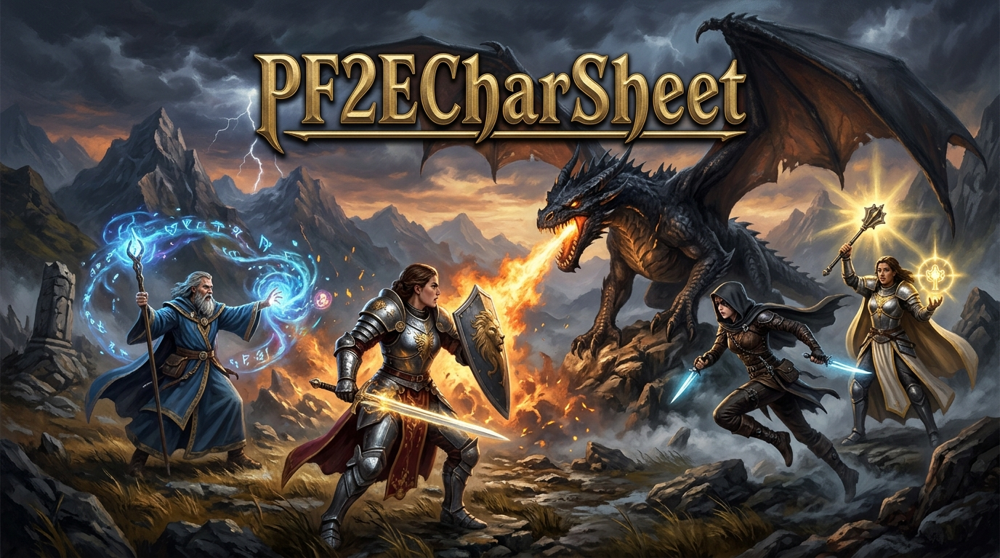

> **[Leia em Português (PT-BR)](README-PT.md)**

# Pathfinder Character Manager 2eR

Desktop and web character manager for **Pathfinder 2e Remaster**, built with React, TypeScript, Electron, and SQLite.

## Key Features

- **ABC Character Creator**: Step-by-step wizard for Ancestry, Background, Class, Level 1 Free Boosts, and Initial Trained Skills (with automatic background/class skill calculation and overlap compensation).
- **Character Sheet & Level Progression (1–20)**:
  - **Combat**: Session HP tracking, conditions, shield block/AC, and melee/ranged Strikes.
  - **Skills**: 16 core skills + custom **Lore** skills with T/E/M/L proficiency ranks.
  - **Feats**: Ancestry, Class, General, Skill, and optional Free Archetype slots with prerequisite checks and Archetype/Multiclass/Dedication filters.
  - **Spells**: Spell Attack, Spell DC, Spell Slots (1–10), Linked Spellbook, and Signature Spells.
  - **Inventory & Bulk**: Equipment catalog, coins, equipped armor/shield automation, and Bulk calculation (`5 + STR` encumbered / `10 + STR` max).
  - **Companions**: Animal companions, familiars, eidolons, and constructs.
  - **Level Progression**: 1–20 planner with partial attribute boosts (`+4` and above), level-capped skill increases (`3+/7+/15+`), and configurable HP progression (PF2e standard, rounded-up average, or per-level die roll).
- **Spellbook Builder & Compendiums**: Searchable compendium browser for Spells, Feats, and Equipment, plus a dedicated Spellbook Builder with tarot card printing and JSON export.
- **Export & Import**: Export characters to fillable Pathfinder 2e PDF (with embedded portrait) or `.pf2char.json`, and import `.json` character files.
- **Bilingual UI**: Switchable between English and Portuguese (`pt-BR`), with Light, Dark, and Navy themes.

## Development Setup

Requires **Node.js 22.13+** with `node:sqlite` available.

```sh
npm install
npm run dev
```

Installation creates `pf2e.db` with the required schema if it does not exist yet. The command is idempotent and preserves existing characters, spellbooks, and compendiums. To initialize manually:

```sh
npm run db:init
```

The database is local and not tracked by Git. It stores your characters and spellbooks, so include it in your personal backups.

## Compendium Data

On a fresh database, `npm install` also attempts to download the [Foundry PF2e](https://github.com/foundryvtt/pf2e) repository at revision `52dfeee703b887237f5e454747bcae45b136f9af` and import its JSON data. If the download fails, the empty database is preserved and instructions are printed to retry. Existing populated databases are not overwritten automatically.

To import or update manually:

```sh
npm run db:import-foundry
```

To use a local Foundry checkout without downloading again:

```sh
npm run db:import-foundry -- --source=/path/to/pf2e
```

You can also set `FOUNDRY_SOURCE_DIR`, `--db=/path/to/db.sqlite`, or `SQLITE_DB_PATH`. Imports update compendium entries by ID while preserving characters and spellbooks.

The importer covers ancestries, heritages, backgrounds, classes, feats, spells, equipment, actions, conditions, and deities. Foundry code and data carry their own license and attribution terms; refer to the upstream repository before redistributing them.

## Building Desktop Binaries

```sh
npm run build       # TypeScript check + Vite production bundle
npm run dist:all    # Prepare clean compendium DB + build Electron packages (macOS, Windows, Linux)
```

## Support & Donations

If this project helps your Pathfinder 2e table, consider supporting its development:

- **Pix**: `caquintella@gmail.com` (R$ 10 suggested)
- **PayPal**: `caquintella@gmail.com` ($2 suggested)
